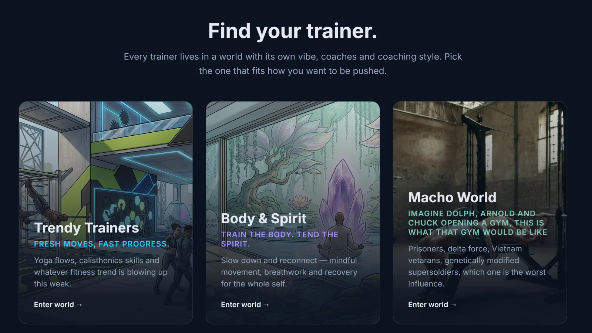
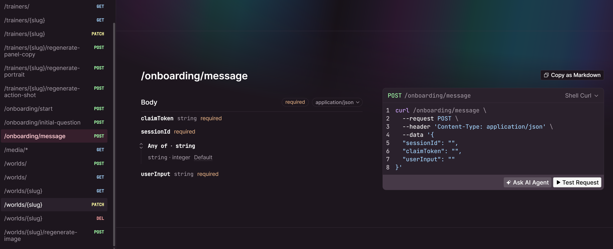

# megaTrainer

**megaTrainer is a small gym app where the personal trainers are AI personas** — each with a generated portrait, a voice, and an onboarding chat that turns a conversation into a structured user profile. It's a real, working app, built to get AI properly wired in end to end: image generation, text generation, and conversation interpreted against a goal.

> **Fun fact:** everything runs locally on my own laptop — the LLM and image generation included. No data leaves the machine, no subscriptions, no API calls to Google, Anthropic, or anyone else. Just my laptop GPU doing the work.

*Arne Kommando doesn't do small talk. He does generated portraits and generated opening pitches like this one:*


**If you're short on time:** the ["How it works"](#how-it-works) section below, on splitting the onboarding chat into a persona model and a neutral assessor model, is the part of this project I'd most want to talk through.

## Why I built it

I wanted a training app that has integrated AI buzzwords 😊

**Can personal trainers be replaced by AI? Maybe, probably not — but I'll give it a shot.**

A real gym has five personal trainers who mostly train the same way. This one has worlds of weird trainers, all acting out prompts I feed them. You give it a trainer idea and a world, and the image generator and LLM services make the media and text, which goes into the database and later shows up in the web-interface.

*The worlds you create can be edited, afterall, like I did with Macho World, its obviously the pen an 80s action movie enthusiast, not AI.*



## The natural language interview with the trainer
Is a chat interview more efficient than a form, especially in the day and age of autocomplete? 
After building this, I think it depends on the question. Name, address and the like are still faster and more user-friendly handled by the browser's autocomplete — but figuring out whether a user has given a valid, measurable motivation and goal is where a chat interview really shines, and outperforms most form validation I've built before. 

The overall goal of the interview is to build a user profile that can be used later when creating workouts for the user. So we are looking for stuff like motivations, name, age, previous experience, and performance data. All kinds of personalities (prompted personalities) follow the same interview format and then record the data as the interview progresses. 

Let's take a look at an example. 

*Here the trainer has asked for Name, age and location, the user replies with only name and location. The information we asked for and the information given have both been identified, shown in green, but we are not done with phase one until we have the location, so trainer asks again, this time only for the information he is missing. 


*So regardless of what sport and what trainer, the form is the same, here you see it moves to phase 2 after phase 1 is completed*


*But even if the form is the same for all trainers, the label they stick on each question is different depending on their personality and language. Here is a mean Norwegian lady* 


Behind the scenes a JSON profile is built for the user. Notice how we also filled in both country and gender even if this was never given by the user. But it is instructed to give a reason for its assumptions.  


## How it works
My first idea when making this was to let all my trainers follow an interview guide. It derailed almost immediately — different personas interpret "interview" differently. The more context I gave the LLM the more they drifted away from giving answers that looked like a user file. An unpredictable user input did not make it easier. The fix was shorter, clearer system prompts for each phase and splitting the job across two LLM requests with different system prompts rather than asking one prompt to do everything.

So its split into the trainer response and a neutral assessor that generates the JSON file. 

Here is where the instructions for the example above was written. [`coach-engine/phases/onboarding/message/instructions/instructions_basic_info.ts`](coach-engine/phases/onboarding/message/instructions/instructions_basic_info.ts)


The assessor never speaks to the user. It reads the user's answer against the current profile, decides whether the answer actually covers what was asked, and returns the full profile as JSON — updating what it can and flagging what is still missing in a followUp field. 

The trainer persona receives the updated profile and either advances the phase or asks a follow-up in its own voice. It never sees the raw assessment.

This is also good for catching out of phase information. If the user says something about their motivations when the trainer just asks for name, age and location, then we put in in the profile, and the trainer will not ask that question again. 

Separating these is the central design decision. A single model asked to converse and judge the conversation tends to be agreeable — it accepts a vague answer as good enough because it was the one who asked the vague question. The assessor has no persona and no incentive to be nice, which is what makes followUp trustworthy.

To keep conversations from getting stuck in a loop I also added good old fashioned loops and counters for each phase, so that the prompt changes slightly with each attempt, and the trainers escalate their ask. The trainers try more aggressively 3 times to get an answer, then if nothing is provided of what they asked for then they just move along. 

## The stack
I've built on several stacks over the years, from LAMP in 2011 to a relatively modern array of AWS services at work. This one fixes most of what I've disliked along the way — fast iteration and strong typing end to end. Here's what I landed on:

- [Bun](https://bun.sh) - runtime and package manager. Faster than Node in practice, with the occasional compatibility hiccup along the way.
- [Elysia](https://elysiajs.com) - API framework, strongly typed all the way to the front end.
- [SvelteKit 5](https://svelte.dev) - routing, SSR and a file structure I can actually find my way around, without giving up on plain, readable code.
- [PostgreSQL](https://www.postgresql.org) - rows and columns, kept as standard as possible.
- [Drizzle](https://orm.drizzle.team) - schema declared once, TypeScript types for queries for free.
- [Docker](https://www.docker.com) - the reason the whole thing comes up as one command, local GPU included.
- [Ollama](https://ollama.ai) - LLM requests, served as an API endpoint inside Docker.
- [ComfyUI](https://github.com/comfyanonymous/ComfyUI) - local image generation, also inside Docker.
- [Cline](https://cline.bot) - at work I use Copilot; at home I switched to Cline over OpenRouter, which costs me peanuts by comparison.

It runs smooth on an RTX 3080 Ti. Everything comes up with `docker compose up -d`, apart
from the frontend, which I run directly with `bun run dev:web` for hot reload.

## Installing and testing

```bash
bun install && docker compose up -d   # api, postgres, ollama, comfyui
bun run dev:web                       # frontend on the host, for hot reload
bun run check                         # tests + typecheck
```

First boot pulls the Ollama model and the ComfyUI checkpoints, so it takes a while. Its about 40GB
Trainer creation then generates two images and takes ~80s on a GPU. Set
`PORTRAIT_MODEL=lightning` in `.env` for fast drafts.

I have set up AI to run testing, using a Playwright harness that drives the real UI against the real local model and screenshots every turn. Its super useful, I can just tell the AI assistant (Cline) what I wanna test, on what kind of user, and then I just get screenshots of how the conversation went. 

## API

Once the docker runs you can head to [http://localhost:3000/openapi](http://localhost:3000/openapi). 




Elysia just generates the documentation with a single command and I can run test directly in the interface. 

## Next

### Individual long-term training plans
After onboarding interview the user should make a multi-week training plan. Plans typically consist of phases like 
- Base - getting the subject used to the sport
- Build phase - challenging the athlete 
- peak where the user reaches the peak
- taper cooling down and getting ready for race-day. 

How long each of the phases should be varies on the user experience and what type of sport we are doing. A low impact sport with low risk of injury done by a user with no history of injuries and lots of experience, calls for a short base period. So I made a scoring system to generate this. So I just need an AI prompt that can translate a user file into a scoring system.

### Making workouts
So, once we have a trainer with a personality, a user profile with information about what equipment, time resources, motivation and location they are located in, we have a training plan with information about what phase we are currently in. Then from here, it's just to feed it into an AI workout creator. 
Ideally they should be RAG-ed or fine tuned on all kinds of training research and books. 

### Communicating the workouts to the user and evaluating
A trainer sends the workout to the user and evaluates them. Something similar could be done if we ask the user to provide some sort of training data from the workout. Maybe a Garmin file or self evaluation. The result of the workout gets fed to the user profile history property, which again can be used to adjust the intensity up or down depending on how the user responds to the training. 

### It runs locally and is basically free — but with a catch
I picked LLM and image generation models that are just big enough to fit onto my laptop's 16GB of VRAM — Gemma for chat and assessment, Juggernaut-XL for portraits. It can generate a response to the user in about 7 seconds. The quality and speed of the images and messages could of course be substantially better with a frontier model from a big AI company, but that comes at a real per-call cost. It's good for testing, but for scale it would eventually need to connect to a hosted API.
