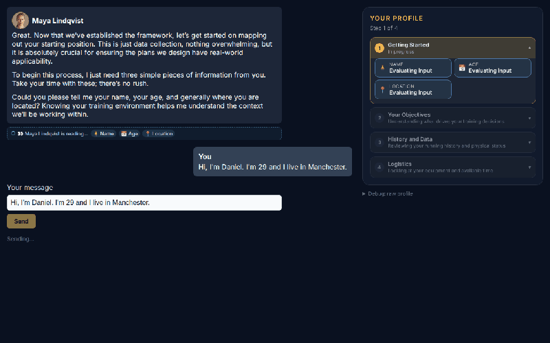
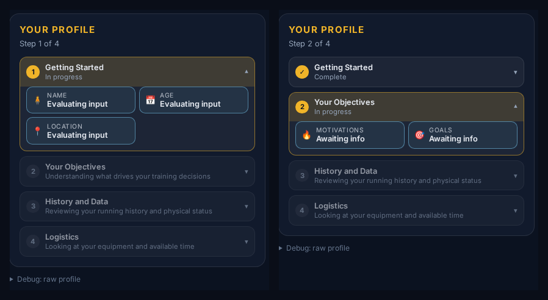

# megaTrainer

> A learning project. I'm building it to understand how multi-agent LLM systems
> behave when their output is parsed by code rather than read by a human.

An AI coaching platform. A user has a structured onboarding interview with an
AI-generated trainer persona, who builds a structured profile of them along the way.
Every trainer gets its own personality, world, panel wording and generated face.
Everything runs locally — no cloud LLM, no API keys.



**Stack:** [Bun](https://bun.sh) · [Elysia](https://elysiajs.com) · [SvelteKit 5](https://svelte.dev) · [PostgreSQL](https://www.postgresql.org) · [Drizzle](https://orm.drizzle.team) · [Ollama](https://ollama.ai) · [ComfyUI](https://github.com/comfyanonymous/ComfyUI)

---

## What I wanted to learn

**A strongly typed stack, end to end.** This is the thing I've struggled to find in
other places, and I got it here: Drizzle infers row types from the schema
(`typeof trainerTable.$inferSelect`), the Elysia app exports its own type
(`export type App = typeof app`), and the SvelteKit frontend consumes exactly that via
`treaty<App>`. Change a response shape and the frontend fails to compile. There is no
hand-written DTO layer to drift.

**How far a persona can be pushed before the structure breaks.** My first instinct was
many different AI trainers all following one shared interview guide. It derailed almost
immediately. Different personas interpret "interview" differently, the prompts fight
each other, and the output becomes chaotic.

The lesson that unlocked it: **LLMs are very talkative, and the more context you give
them the more they drift.** Especially with unpredictable user input. The fix was
shorter, clearer system prompts — and splitting the job across two models instead of
asking one model to do everything.

## How it works

The interview runs as four ordered phases, each owning a fixed set of profile fields:
`basicInfo` → `motivationsAndGoals` → `backgroundAndMetrics` → `toolsAndTime`.

Each user turn goes to **two separate LLM calls with different system prompts**:

1. **The assessor** never speaks to the user. It reads the user's answer against the
   current profile, decides whether the answer actually covers what was asked, and
   returns the full profile as JSON — updating what it can and flagging what is still
   missing in a `followUp` field.
2. **The trainer persona** receives the updated profile and either advances the phase
   or asks a follow-up in its own voice. It never sees the raw assessment.

Separating these is the central design decision. A single model asked to converse *and*
judge the conversation tends to be agreeable — it accepts a vague answer as good
enough because it was the one who asked the vague question. The assessor has no persona
and no incentive to be nice, which is what makes `followUp` trustworthy.



The assessor's prompt also states that JSON keys must stay in English while values
follow the user's language, so a Norwegian conversation still merges correctly.

### One bug that changed my mind about the design

`mergeProfiles` originally **discarded** any field the current phase didn't own. The
intent was to stop the model fabricating a background out of the selected sport. But a
user who volunteered "I used to run at school but stopped for years" during the
*motivations* phase had that sentence silently deleted. Since nobody repeats
themselves, the field stayed empty and onboarding could never complete.

The fix was to **demote rather than discard**: out-of-phase content becomes an
`unclassifiedNotes` entry, and a classifier — which only ever sees real user text —
decides if it deserves a field. Fabrication becomes a note that gets dropped; genuine
statements get routed. The original guard still holds, and it's pinned by tests.

This only surfaced because I tested a *normal* user. The military persona and the
deliberately evasive user never triggered it.

## Verification

19 tests, plus a Playwright harness that drives the real UI against the real local model
and screenshots every turn. That's how the bug above was found — it exercises
cooperative, normal and evasive users across three trainer personas rather than one
happy path.

```bash
bun install && docker compose up -d
bun run dev:api      # terminal 1 — http://localhost:3000
bun run dev:web      # terminal 2 — http://localhost:5173
bun run check        # tests + typecheck
```

Trainer creation generates two images through ComfyUI and takes ~80s on a GPU. Set
`PORTRAIT_MODEL=lightning` in `.env` for fast drafts.

## API

`/trainers` · `/worlds` · `/media/*` · `/onboarding/start` · `/onboarding/initial-question` · `/onboarding/message`

Sessions are authorised by a `claimToken`; a session id alone is not sufficient, and an
invalid token returns 404 rather than confirming the session exists.

## Known limitations

Real, and stated rather than implied.

- **No session rehydration** — no `GET /onboarding/session/:id`, so a refresh loses the
  conversation. The biggest gap.
- **Unknown `trainerId` returns 500**, not 404.
- **Fields that don't apply to a sport.** Phases require every field they own, so a yoga
  user with no times and no injuries must answer "no" repeatedly before the give-up path
  moves on. A real fix is a per-sport "not applicable" affordance.
- **Assessment JSON compliance is flaky** — the model sometimes translates keys or wraps
  output. There's retry logic and failures log raw output, but it isn't solved.
- **API base URL hardcoded** in 19 places in the frontend.
- **No auth**, and **no linter** configured. `bun run check` is tests + typecheck only.
- **Dead code:** `routes/debug/` calls a route that doesn't exist;
  `waitingScreen/page.svelte` is missing the `+` prefix so it was never a route.

## Next

Session rehydration → one config module for the API URL → route colours through the
existing `--mt-*` tokens → 404 for unknown trainer → delete the dead routes.

## Licence

Learning project, no licence granted. The type chain and the two-model onboarding design
are the parts I'd most want to talk through.
