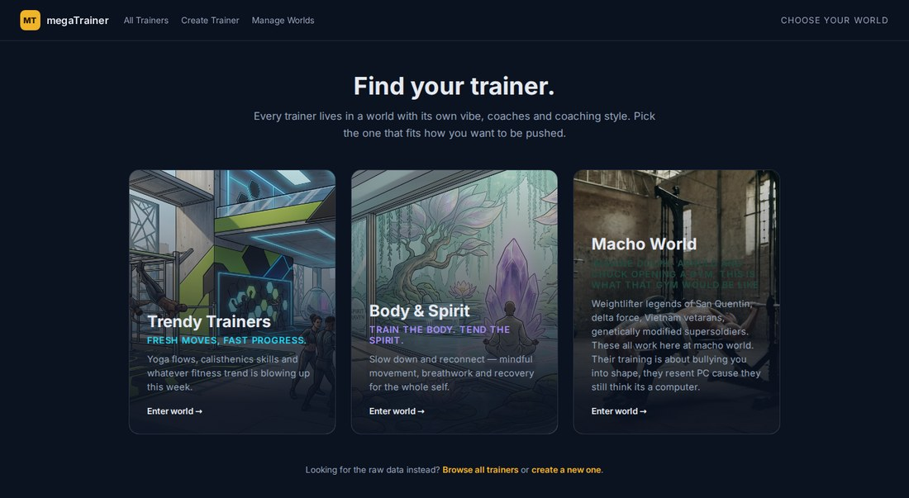
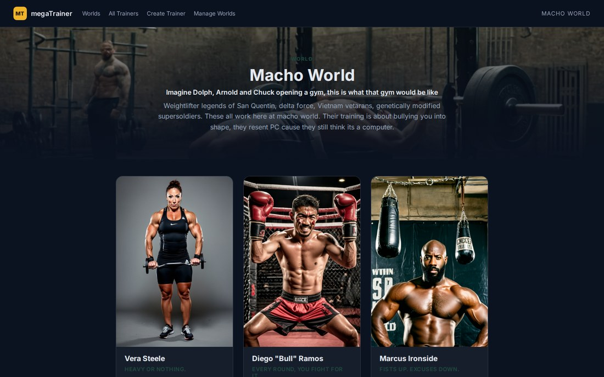

# megaTrainer

I talk to a commercial AI trainer quite a lot. It's genuinely good at telling me what I
want to hear, and genuinely bad at holding a plan for longer than a few weeks. Somewhere
in the third week it stops remembering what I told it in the first.

That's partly a product problem and partly a design one. A chatbot has no reason to write
anything down: the whole state of you lives in a scrollback buffer, and once that window
slides, the model is guessing from whatever it can still see. I wanted the opposite — a
trainer that talks to you like a person, but keeps a structured record, so what it tells
you in week nine is built on what it actually learned in week one.

megaTrainer is my answer to that, and my excuse to catch up on a lot of things I'd missed.

## What this was also for

I needed a learning project, and I'd fallen behind on a few things: SSR, Docker, and
most of all using LLMs and image generation directly inside an app rather than through a
hosted SDK. I'd never run a Docker container before, so I gave myself a hard constraint —
**no cloud services, not even for the model.** Everything runs on my own machine:

- **Postgres, the API, Ollama and ComfyUI all run in Docker Compose.** The LLM and the
  image generation are containers too, both with GPU passthrough, so the only traffic
  crossing the network is between them.
- **No API keys anywhere.** The model is a local Ollama model, the images come from a
  local ComfyUI. Nothing about your profile leaves the machine.
- **SvelteKit does SSR** on the world and trainer pages — a `+page.server.ts` fetches
  through Elysia Eden on the server, so the trainer list is in the HTML before any
  JavaScript runs.

It runs smooth on an RTX 3080 Ti. Everything comes up with `docker compose up -d`, apart
from the frontend, which I run directly with `bun run dev:web` for hot reload.


That GIF is the whole idea in one turn. You send an ordinary sentence. The trainer reads it
for facts, writes them into a structured profile, and replies as a character — using your
name and your city, because it just learned them rather than because you filled in a box.

**Stack:** [Bun](https://bun.sh) · [Elysia](https://elysiajs.com) · [SvelteKit 5](https://svelte.dev) · [PostgreSQL](https://www.postgresql.org) · [Drizzle](https://orm.drizzle.team) · [Docker](https://www.docker.com) · [Ollama](https://ollama.ai) · [ComfyUI](https://github.com/comfyanonymous/ComfyUI)

---

## The design problem

**A conversation can replace a form, but only if something writes the answers down.** A
form is a bad conversation — it asks you to know what it wants before it can help you, and
it can't tell that "I get winded after a minute" is your real problem until you've already
answered six unrelated questions. Chatting is better at that, and an LLM is good at
pulling facts out of a sentence. The catch is that LLM output isn't a form submission. It's
prose, it's inconsistent, and it arrives in whatever shape the model felt like that day.
Most of what follows is about surviving that.

**One interview guide, many trainers.** Every trainer runs the same four-phase interview
over the same fixed set of fields, because they all feed the same downstream consumer: a
personalised training plan. What varies per trainer is who is asking and how. The output
is a file, not a transcript.

## A trainer is generated, not written

You pick a **world** — a setting with its own aesthetic and coaching register — and a
trainer inside it. The world defines the vibe; the trainer defines the voice. Both the
cover art and the trainer's face are generated locally through ComfyUI.



Each world has its own generated cover art and its own tone. Body & Spirit is calm and
mindful; Macho World is deliberately blunt and a bit comic.


Ten trainers exist so far, each constructed from a name, a personality description, a
sport list and a world. From that input the system generates a tagline, a greeting, the
panel's own field labels and icons, a portrait and an action shot. The Norwegian trainers
run the same interview guide in Norwegian.



This is what makes the form-replacement idea tractable. If onboarding is a conversation
with a character, then a user who picks Macho World and one who picks Body & Spirit have
very different relationships with the intake process — and neither is filling in a form.

## How the interview works

The interview runs as four ordered phases, each owning a fixed set of profile fields:
`basicInfo` → `motivationsAndGoals` → `backgroundAndMetrics` → `toolsAndTime`.

Each user turn goes to **two separate LLM calls with different system prompts**:

1. **The assessor** never speaks to the user. It reads the user's answer against the
   current profile, decides whether the answer actually covers what was asked, and
   returns the full profile as JSON — updating what it can and flagging what is still
   missing in a `followUp` field.
2. **The trainer persona** receives the updated profile and either advances the phase
   or asks a follow-up in its own voice. It never sees the raw assessment.

Separating these is the central design decision. A single model asked to converse *and*
judge the conversation tends to be agreeable — it accepts a vague answer as good
enough because it was the one who asked the vague question. The assessor has no persona
and no incentive to be nice, which is what makes `followUp` trustworthy.


The assessor's prompt also states that JSON keys must stay in English while values
follow the user's language, so a Norwegian conversation still merges correctly.

## Two things that turned out harder than expected

**Keeping the persona inside the schema.** My first instinct was many different AI trainers
all following one shared interview guide. It derailed almost immediately — different personas
interpret "interview" differently, the prompts fight each other, and the output becomes
chaotic. The lesson that unlocked it: **LLMs are very talkative, and the more context you
give them the more they drift**, especially with unpredictable user input. The fix was
shorter, clearer system prompts, and splitting the job across two models rather than asking
one model to do everything.

**A strongly typed stack, end to end.** Drizzle infers row types from the schema
(`typeof trainerTable.$inferSelect`), the Elysia app exports its own type
(`export type App = typeof app`), and the SvelteKit frontend consumes exactly that via
`treaty<App>`. Change a response shape and the frontend fails to compile. There is no
hand-written DTO layer to drift — which matters more than usual here, because the thing
being typed is LLM output.

### One bug that changed my mind about the design

`mergeProfiles` originally **discarded** any field the current phase didn't own. The
intent was to stop the model fabricating a background out of the selected sport. But a
user who volunteered "I used to run at school but stopped for years" during the
*motivations* phase had that sentence silently deleted. Since nobody repeats
themselves, the field stayed empty and onboarding could never complete.

The fix was to **demote rather than discard**: out-of-phase content becomes an
`unclassifiedNotes` entry, and a classifier — which only ever sees real user text —
decides if it deserves a field. Fabrication becomes a note that gets dropped; genuine
statements get routed. The original guard still holds, and it's pinned by tests.

This only surfaced because I tested a *normal* user. The military persona and the
deliberately evasive user never triggered it.

## Verification

19 tests, plus a Playwright harness that drives the real UI against the real local model
and screenshots every turn. That's how the bug above was found — it exercises
cooperative, normal and evasive users across three trainer personas rather than one
happy path.

```bash
bun install && docker compose up -d   # api, postgres, ollama, comfyui
bun run dev:web                       # frontend on the host, for hot reload
bun run check                         # tests + typecheck
```

The API is in the Compose file with a dev Dockerfile, but I normally run it on the host
too (`bun run dev:api`) so I get stack traces and fast restarts; both reach the same
Postgres, Ollama and ComfyUI over the Compose network. Compose alone is enough to get
everything talking.

First boot pulls the Ollama model and the ComfyUI checkpoints, so it takes a while.
Trainer creation then generates two images and takes ~80s on a GPU. Set
`PORTRAIT_MODEL=lightning` in `.env` for fast drafts.

## API

`/trainers` · `/worlds` · `/media/*` · `/onboarding/start` · `/onboarding/initial-question` · `/onboarding/message`

Sessions are authorised by a `claimToken`; a session id alone is not sufficient, and an
invalid token returns 404 rather than confirming the session exists.

## Known limitations

Real, and stated rather than implied.

- **No session rehydration** — no `GET /onboarding/session/:id`, so a refresh loses the
  conversation. The biggest gap.
- **Unknown `trainerId` returns 500**, not 404.
- **Fields that don't apply to a sport.** Phases require every field they own, so a yoga
  user with no times and no injuries must answer "no" repeatedly before the give-up path
  moves on. A real fix is a per-sport "not applicable" affordance.
- **Assessment JSON compliance is flaky** — the model sometimes translates keys or wraps
  output. There's retry logic and failures log raw output, but it isn't solved.
- **API base URL hardcoded** in 19 places in the frontend.
- **No auth**, and **no linter** configured. `bun run check` is tests + typecheck only.
- **Dead code:** `routes/debug/` calls a route that doesn't exist;
  `waitingScreen/page.svelte` is missing the `+` prefix so it was never a route.

## Next

Session rehydration → one config module for the API URL → route colours through the
existing `--mt-*` tokens → 404 for unknown trainer → delete the dead routes.

## Licence

No licence granted. The form-replacement idea, the two-model onboarding split and the
generated-trainer pipeline are the parts I'd most want to talk through.
