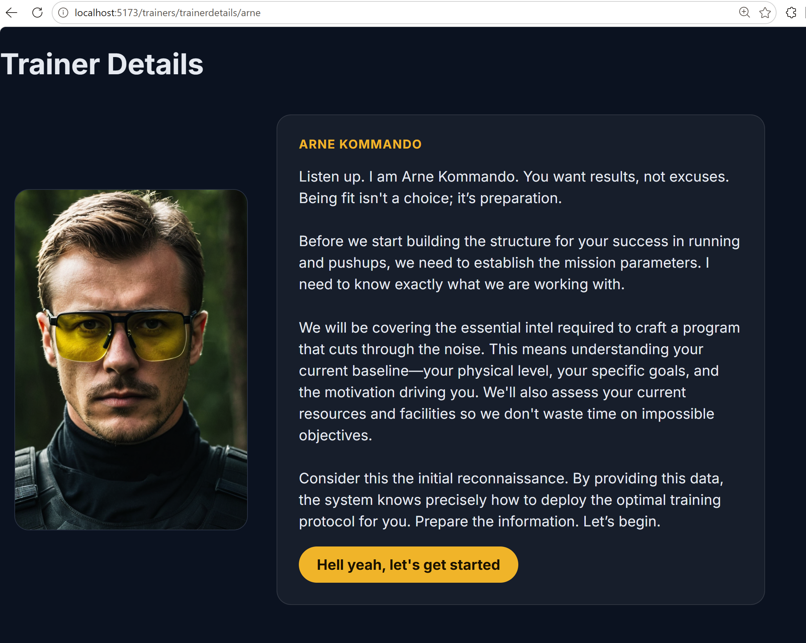
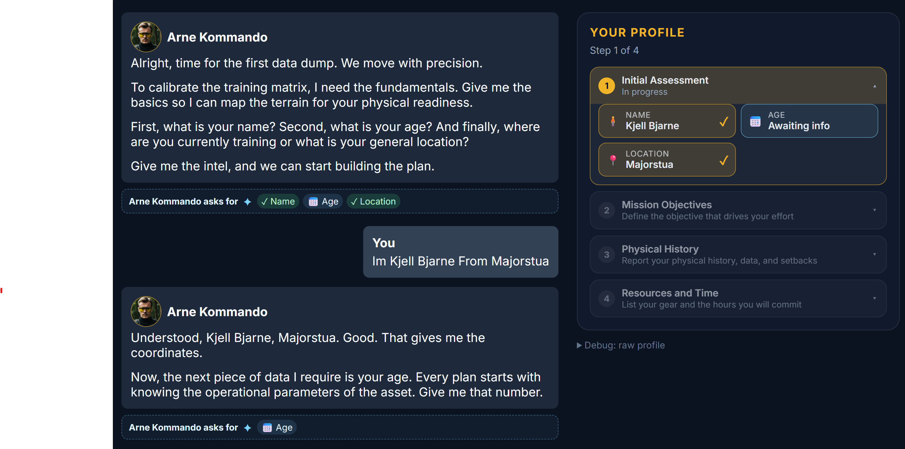
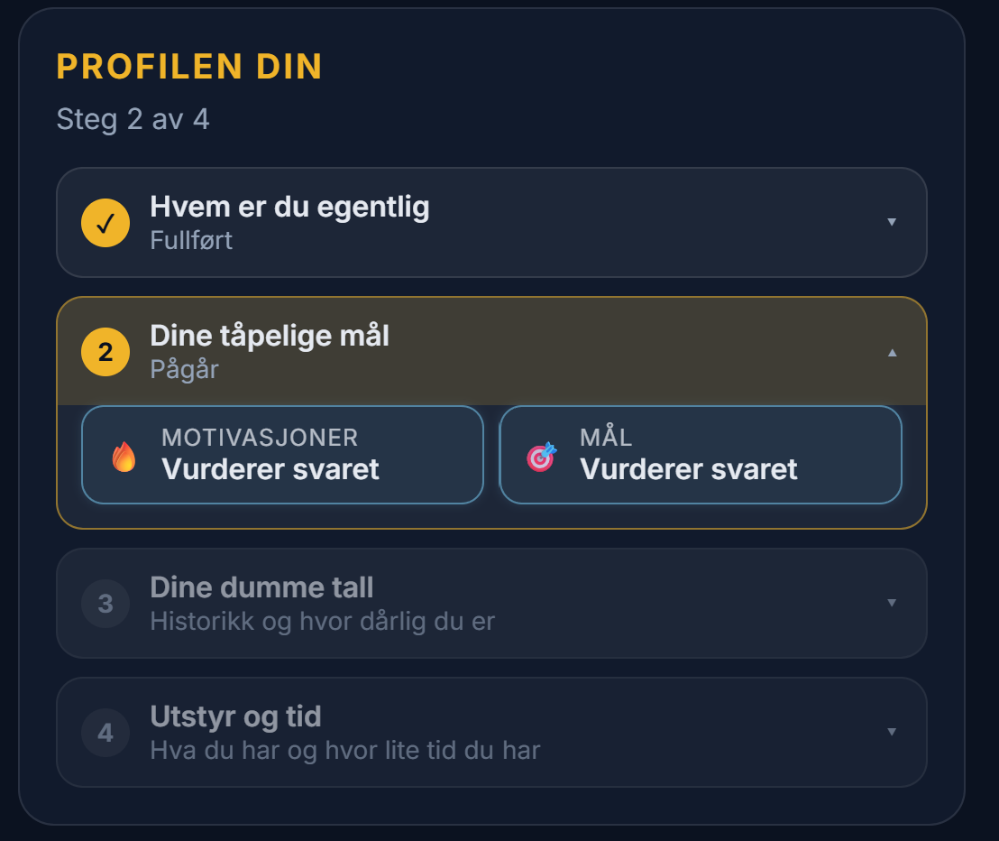
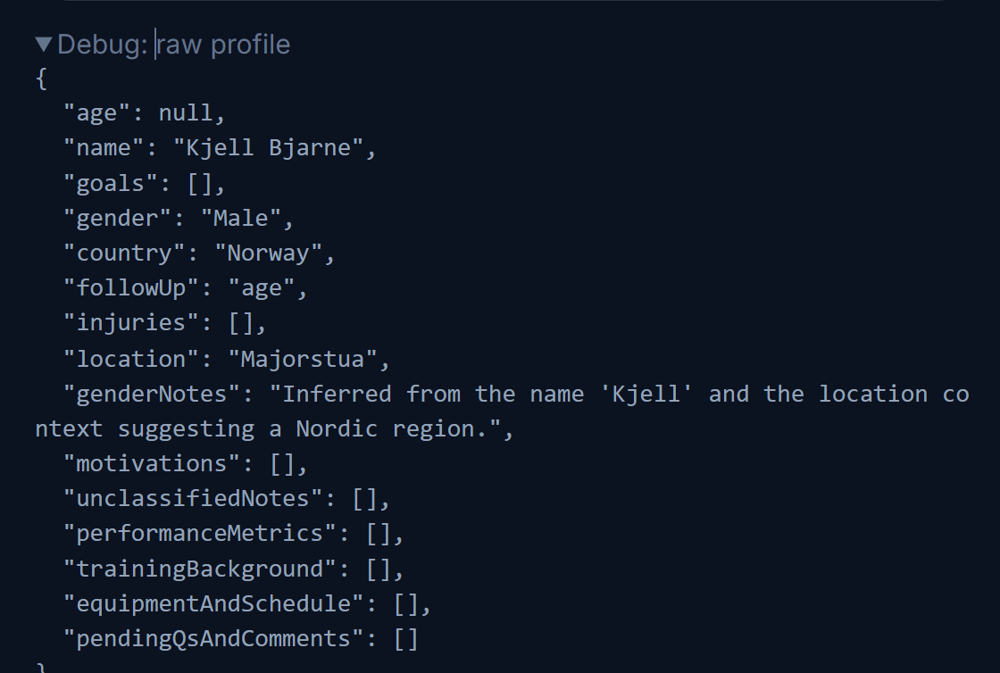

# megaTrainer
## I wanted to make a training app that has integrated AI buzzwords 😊
I have always made useful web-apps to help me do my work. Some of them are even successful. This app was a training project so I can learn how to use AI tools as an integrated part of a web-app. This app uses image generation, text generation, and interprets text in relation to set goals and objectives. 

### Why AI trainers are cooler than real Personal trainers. 
Can personal trainers be replaced by AI. Maybe, probably not, but I will give it a shot. 

So where an actual fitness center only has 5 real personal trainers that all have the similar personality and training. My virtual gym has worlds of weirdo trainers that are all acting out on the weird prompts I feed them. 

You just need an idea for a trainer and what world the trainer belongs in, and then the image generator and LLM services makes media and text that is inserted in the database and later shown in the web-interface. 

*The worlds you create can be edited, afterall, like I did with Macho World, its obviously the pen an 80s action movie enthusiast, not AI.*


*Every trainer gets a generated portrait and an opening pitch written in their voice:*


## The natural language interview with the trainer
Is a chat interview more efficient than a form. Especially in the day and age of autocomplete? 
Hey, honestly, probably not, but it does provide a fun meet with your new trainer. And Maybe the form is filled out better. Lets see how it works. 

The overall goal of the interview is to build a user profile that can be used later when creating workouts for the user. So we are looking for stuff like motivations, name, age, previous experience, and performance data. All kinds of personalities (prompted personalities) follow the same interview format and then record the data as the interview progresses. 

Lets take a look at an example. 

*Here the trainer has asked for Name, age and location, the user replies with only name and location. The information we asked for is and is given has been identified as green, but we are not done with phase one until we have the location, so trainer asks again, this time only for the information he is missing. 



*So regardless of what sport and what trainer, the form is the same, here you see it moves to phase 2 after phase 1 is completed*


*But even if the form is the same for all trainers, the label they stick on each question is different depending on their personality and language. Here is a mean Norwegian lady* 


Behind the scenes a JSON profile is built for the user. Notice how we also filled in both country and gender even if this was never given by the user. But it is instructed to give a reason for its assumptions.  



## How it works. 
My first idea when making this was to let all my trainers follow an interview guide. It derailed almost immediately — different personas interpret "interview" differently. The more context I gave the LLM the more they they drifted away from giving answers that looked like a user file. An unpredictable user input did not make it easier. The fix was shorter, clearer system prompts for each phase and splitting the job across two LLM requests with different system prompts rather than asking prompt to do everything.

So its split into the trainer response and a neutral assessor that generates the JSON file. 

Here is where the instructions for the example above was written. [`coach-engine/phases/onboarding/message/instructions_basic_info.ts`](coach-engine/phases/onboarding/message/instructions/instructions_basic_info.ts)


The assessor never speaks to the user. It reads the user's answer against the current profile, decides whether the answer actually covers what was asked, and returns the full profile as JSON — updating what it can and flagging what is still missing in a followUp field. 

The trainer persona receives the updated profile and either advances the phase or asks a follow-up in its own voice. It never sees the raw assessment.

This is also good for catching out of phase information. If the user says something about their motivations when the trainer just asks for name, age and location, then we put in in the profile, and the trainer will not ask that question again. 

Separating these is the central design decision. A single model asked to converse and judge the conversation tends to be agreeable — it accepts a vague answer as good enough because it was the one who asked the vague question. The assessor has no persona and no incentive to be nice, which is what makes followUp trustworthy.

To keep converstations from getting stuck in a loop I also added good old fashioned loops and counters for each phase, so that the prompts changes slightly for each phase attempt to answer a question. The trainers try more agressivly 3 times to get an answer, then if nothing is provided of what they asked for then they just move along. 

## Not only AI buzz, but also a spankin new stack. 
Since I made my first real web app in PHP app in 2011 I have always struggled been annoyed at the errors I get from cloud functions. This time I wanted a developer experience that was Faster and more furious than Dom Toretto 🏎️ 🍕 and stronger typed than if John Rambo himself was coding in the 90's. 🎀🏹💪 

**What I eventually chose:**
- [Bun](https://bun.sh) - Is it faster and better than Node? YES. Is the package manager so awesome? YES. Did I have compatibility issues along the way, yes, but not soo bad. 
- [Elysia](https://elysiajs.com) - For creating an API that is stronged typed all the way to the front end. 
- [SvelteKit 5](https://svelte.dev) - Deep down I wanted vanilla HTML and JS. I mean AI is typing it all anyway. But since I also wanted routing, easy to read code, a good file structure and intuitive SSR. I chose Svelte. 
- [PostgreSQL](https://www.postgresql.org) - I mean, its a database, rows and columns. The more standard it can be the better. 
- [Drizzle](https://orm.drizzle.team) - I just declare a schema and it handles Typescript typing for making querys. 
- [Docker](https://www.docker.com) - At least works on my computer. 
- [Ollama](https://ollama.ai) - Runs in the docker as API endpoint for the LLM requests.  
- [ComfyUI](https://github.com/comfyanonymous/ComfyUI) - For image generation locally. Runs in the docker. 
- [Cline](https:cline.bot) - On my real job I use Copilot, but at home I just switched to Cline running through OpenRouter and costing me peanuts and dimes compared to everything else. 

It runs smooth on an RTX 3080 Ti. Everything comes up with `docker compose up -d`, apart
from the frontend, which I run directly with `bun run dev:web` for hot reload.

## Verification
I have set up AI to run testing, using a Playwright harness that drives the real UI against the real local model and screenshots every turn. Its super useful, I can just tell the AI assistant (Cline) what I wanna test, on what kind of user, and then I just get screenshots of how the conversation went. 

```bash
bun install && docker compose up -d   # api, postgres, ollama, comfyui
bun run dev:web                       # frontend on the host, for hot reload
bun run check                         # tests + typecheck
```

First boot pulls the Ollama model and the ComfyUI checkpoints, so it takes a while. Its about 40GB
Trainer creation then generates two images and takes ~80s on a GPU. Set
`PORTRAIT_MODEL=lightning` in `.env` for fast drafts.

## API

`/trainers` · `/worlds` · `/media/*` · `/onboarding/start` · `/onboarding/initial-question` · `/onboarding/message`

Once the docker runs you can head to [http://localhost:3000/openapi](http://localhost:3000/openapi). 

Elysia just generates the documentation with a single command and I can run test directly in the interface. 

## Next

### Individual long term training plans.
After onboarding interview the user should make a several week long training plan. Plans typically consists of phases like 
- Base - getting the subject used to the sport
- Build phase - challenging the 
- peak where the user reaches the peak
- taper cooling down and getting ready for race-day. 

How long each of the phases should be varies on the user experience and what type of sport we are doing. A low impact sport with low risk of injury done by a user with no history of injuries and lots of experience, calls for a short base period. So I made a scoring system to generate this. So I just need an AI prompt that can translate a user file into a scoring system.

### making workouts.
So, once we have a trainer with a personality, a user profile with information about what equipment, time resources, motivation and location they are located in, we have a training plan with information about what phase we are currently in. Then from here, its just to feed it into an AI workout creator. 
Ideally they should be RAG-ed or fine tuned on all kinds of training research and books. 

### communicating the workouts to the user and evaluating. 
A trainer sends the workout to the user and evaluates them. Something similar could be done if we ask the user to provide some sort of training data from the workout. Maybe a Garmin file or self evaluation. The result of the workout gets fed to the user profile history property, which again can be used to adjust the intensity up or down depending on how the user responds to the training. 


## Licence

No licence granted. The form-replacement idea, the two-model onboarding split and the
generated-trainer pipeline are the parts I'd most want to talk through.
